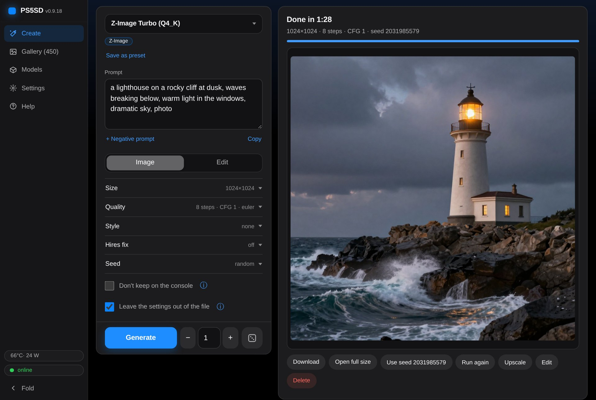
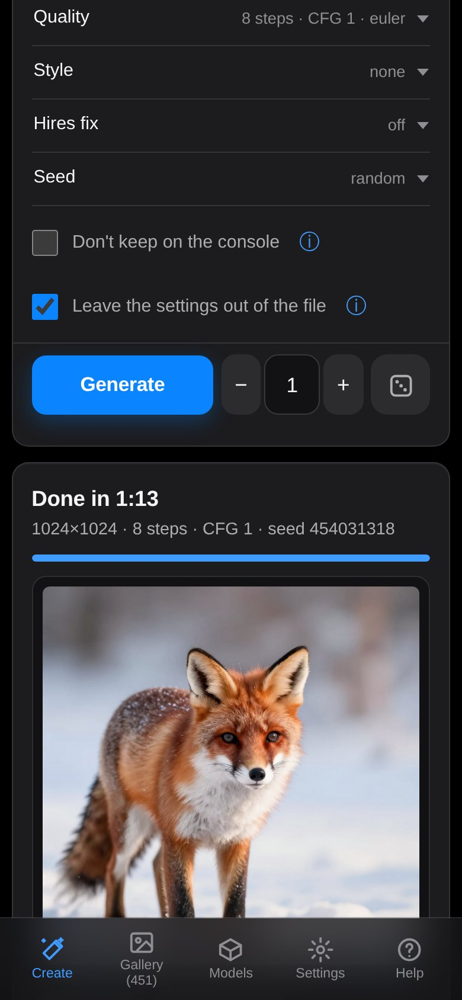
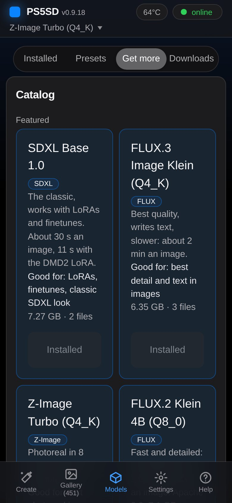
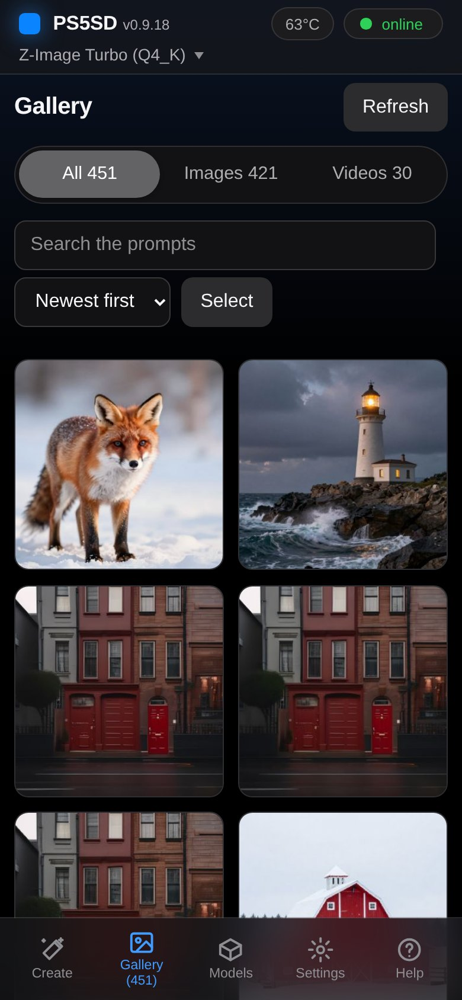

# PS5SD

stable-diffusion.cpp on the PS5 GPU — a native title running ggml-vulkan on RADV, with an
OpenAI/A1111-compatible image API, a browser UI and a TV dashboard.

> **Status: 0.9.18.** The title runs the server, the web UI, the model downloader and the TV dashboard
> on the console. 0.2.0 added LoRAs; 0.3.0 several images per run, your own size buttons, a done sound
> and a switch that keeps images and prompts off the TV; 0.3.1 an API key (for access from outside your
> network) and a Presets tab; 0.4.0 the hires fix and an Upscale button. 0.5.0 adds image to image and
> inpainting: start from any image, paint a mask over what should change, and only that part is made
> again. 0.5.2 shows the console's address on the TV with a QR code: a phone's camera opens the web UI. 0.6.0
> makes short videos with Wan 2.1 (2 seconds at 832x480 in about 15 minutes), played in the page and the
> gallery, and offers two LoRAs that make SDXL models fast. 0.7.0 adds ControlNet
> (a guide image whose edges set the layout, with SDXL) and CausVid, which makes a video in under 4 minutes. 0.7.1 adds a refine pass (the hires fix at ×1) and says why a run failed, out of memory for one. 0.8.0 rebuilds the web UI for clarity: five tabs, settings in groups, a count next to Generate that queues any number of images, a Models tab in three parts, and the measured time per image in the catalog. 0.8.1 adds FLUX.2 Klein 4B to the catalog (1024x1024 in about 30 s), runs that did not fit in one piece run in segments (SDXL at 2048x2048, Klein 4B at 1536x1536), the page says before a run when it may not fit, LoRAs are sorted by the model family their tensors show, and a PC shows the tabs as a sidebar. 0.9.0 edits a picture by a sentence with FLUX.2 Klein ("make it night"), gives the gallery thumbnails, a search and multi-select, keeps the settings in each PNG and loads them again with **Use all**, and makes GPU memory that earlier runs freed usable again, so larger images run without a restart (FLUX.2 Klein 4B at 2048x2048). 0.9.1 makes videos of up to 5 seconds (81 frames), decodes them in half the time (a 2-second video with CausVid in about 2 minutes 15 s), adds Wan 2.1 with a small, faster decoder, and shows the gallery viewer properly on a phone. 0.9.2 makes an SDXL image in about 30 s instead of 70 (11 s with the DMD2 LoRA), and a fast LoRA sets its own settings when it is added. 0.9.3 shows the console's temperature, power, fan and load on the TV and in the web UI. 0.9.4 works with older ftpsrv versions and says why a file that is only a part of a model cannot be loaded. 0.9.5 zooms in the gallery viewer, gives images names and tags, makes images that are not kept on the console, and adds CLIP skip, prompt starters in a preset and Danbooru tag completion. 0.9.6 makes a video from a picture with Wan 2.2 TI2V 5B (33 frames at 832x480 in about 6 minutes) and shows Flow shift and CLIP skip on the Create tab. 0.9.7 adds FLUX.2 Klein 9B to the catalog (1024x1024 in about 50 s at 4 steps with Euler; the catalog's preset, 8 steps with dpm2, takes about 3 minutes; with its LoRAs). 0.9.8 loads Klein 9B LoRAs in diffusers names fully and keeps running when a run is out of memory. 0.9.9 halves the CPU memory that loading weights takes, so Klein 9B with a LoRA runs right after a start, and a run that is out of memory tries once more. 0.9.10 adds fan modes (Quiet, Balanced, Cool, Manual) that let the fan start earlier, so the chip runs at about 84 °C instead of up to 95 °C in long runs. 0.9.11 gives the web UI a denser look with light and dark themes, a Create tab that needs no scrolling on a PC, Delete under the result and CLIP skip as a number. 0.9.12 lists each model once with its presets, gives each model a default preset, turns LoRAs on and off without losing their strength, uploads several files at once, and writes the time a run took into the image. 0.9.13 updates a preset with the form's settings, lists all presets in one place, applies a preset's settings to another model of its family, can leave the settings out of the image file, and gives a PC the full height without a header bar. 0.9.14 keeps a model's Delete out of the Presets list, explains a preset's lines next to its text with a button for each, and suggests lines, settings, samplers and LoRAs while you type one. 0.9.15 gives every error of the API one shape with a code a program can test, and streams the queue and the progress of a run as server-sent events, which the web UI follows instead of asking every second. 0.9.16 switches the model without stopping the server, so the web UI and the API stay up, waits for the model in A1111's options as A1111 does, and switches to the model an OpenAI request names. 0.9.17 describes the whole API as OpenAPI (`/ps5sd/v1/app/openapi.json`) and keeps a Close from the home screen from ending in a crash report when the title hangs. 0.9.18 measures what was still open (SDXL with the hires fix up to 3072x3072, an upscale to 4096, inpainting, a guide image with the hires fix) and fixes the two ends of the title those runs found. Downloads run at 50 to 75 MB/s from start to end and resume after a close; the web UI uploads
> models from the PC at about 80 MB/s, and its Help tab shows [docs/MODELS.md](docs/MODELS.md) and
> [docs/API.md](docs/API.md). Closing from the home screen during a download used to end in a crash
> report about 1 time in 5; that has not happened in 8 Closes since the download fix. The measurements are in [docs/CONSOLE.md](docs/CONSOLE.md).
>
> Install: unpack the release's `PPSA99576.zip` into `/data/homebrew/` on the console (the zip holds
> the `PPSA99576` folder) and let ShadowMountPlus scan, or install it from the homebrew store.
>
> What comes next (longer videos, more ControlNets): [ROADMAP.md](ROADMAP.md).

## Milestone: the first image made on a PS5

2026-10-19, FW 13.00: `a photograph of an astronaut riding a horse`, SDXS (Q8_0), 512x512, one step,
seed 42, on the console's GPU through ggml-vulkan and RADV, in 2.6 s. Measurements in
[docs/CONSOLE.md](docs/CONSOLE.md).

## The web UI

Open the address the TV shows (or scan its QR code) on a phone or a PC on the same network. **Create**
picks the model, the mode (Image, Edit, Guide, Video) and the settings in groups, with the result next to
them; the count next to **Generate** sends that many images, with new seeds, and more can be queued while
it runs. **Gallery** keeps every image and video, **Models** installs, switches and removes models, LoRAs
and upscalers, **Settings** holds the console's temperature, power, fan and load (also in the header and on the TV), the
done signal, the TV and the API key, and **Help** explains the rest.

  

## The TV

While the title runs, the TV shows a dashboard. At the top is the console's address, with a QR code: a
phone's camera opens the web UI from it. With the API key on, the TV shows the key under the address and the
QR code carries it, so a phone that scans it is signed in. The status shows the phase of a run (loading the
model, sampling) with its progress, the speed, the time so far and the time left. Next to it are a live
preview of the image in the making and the last image. Under the memory bar are the console's temperature,
power, fan and load. In **Settings**, **Show images and prompts on the TV** turns the preview, the images and
the prompts off, and **Show the API key on the TV** (it shows when the API key is on) hides the key.

## Requirements

- A jailbroken PS5. Tested on firmware 13.00 (etaHEN, ShadowMountPlus); other firmwares that run
  ShadowMountPlus may work. It needs:
  - [etaHEN](https://github.com/LightningMods/etaHEN) and kstuff-lite
  - ShadowMountPlus
  - elfldr (port 9021)
  - ftpsrv (port 2121), optional: the model downloader and the web UI's uploads write their files
    through an FTP server, because the console slows a title's own writes to about 2 MB/s after
    1.4 GB. When nothing answers on 2121, or the server there fails a test write (an ftpsrv without
    a command PS5SD needs), the title starts the copy of
    [ftpsrv](https://github.com/drakmor/ftpsrv) it carries (GPL-3.0+, John Törnblom and drakmor;
    `third_party/ftpsrv` at 1.16-ng-stable with `patches/ftpsrv`). That copy listens on
    127.0.0.1:2122 only, so it opens nothing on the LAN. It runs until the console restarts.
    `scripts/ps5sd-app.sh` (deploy, close, log) still needs ftpsrv on 2121.
- Nothing else to run a release. To build it yourself: x86-64 Linux, Docker or WSL2, or GitHub Actions
  ([docs/BUILDING.md](docs/BUILDING.md)).

## Models

The title downloads models itself, from the web UI: a starter catalog (SDXL Base 1.0, FLUX.2 Klein 4B,
FLUX.3 Image Klein, Z-Image Turbo and a few smaller ones; one click installs the files and a preset) or any
Hugging Face or Civitai file URL, with progress, cancel and resume. Downloads keep going while
images are generated. A gated or private Hugging Face repository needs a token in
`/data/PS5SD/hf-token.txt`, a Civitai model that asks for a login one in
`/data/PS5SD/civitai-token.txt` (one line each).

LoRAs go the same ways (as LoRA in the upload or download form; a Civitai LoRA is recognised by
itself) and are picked on the Create tab, several at once, each with a strength.

A model from anywhere else (your own merge or training, another site, a file already on the PC) goes
onto the console with the web UI's upload button or by FTP; [docs/MODELS.md](docs/MODELS.md) has the
steps, the preset format for models of several files, and which models fit. How the downloader works is in
[docs/PORTING.md](docs/PORTING.md#the-model-downloader-downloadercpp-https_clientcpp-download_corecpp-cataloghpp).

## API

Port 7860 serves the web UI and the A1111, OpenAI and sd-server APIs, plus PS5SD's own routes:
- the model library;
- switching and deleting models;
- the downloader;
- the job queue and cancel.

With no model yet, the title starts in standby, so a fresh install can fetch its first model from the
web UI. Every route is in [docs/API.md](docs/API.md).

The API is open on your network until you turn on the API key (web UI, Settings, **API key**). Then
every client needs it, the TV shows it, and the console can be put on the internet behind a Cloudflare
Tunnel or reached through a VPN; [docs/API.md](docs/API.md#the-api-key) shows how. Do not forward port
7860 on your router: the console speaks plain HTTP.

## Building

See [docs/BUILDING.md](docs/BUILDING.md).

## Credits

- [PS5LM](https://github.com/cobanov/PS5LM) by cobanov — the project PS5SD is modelled on.
- [stable-diffusion.cpp](https://github.com/leejet/stable-diffusion.cpp) by leejet, and
  [ggml](https://github.com/ggml-org/ggml).
- [PS5_Vulkan](https://github.com/mihawk-99/PS5_Vulkan) and
  [PS5_Mesa](https://github.com/mihawk-99/PS5_Mesa) by mihawk-99 — the Vulkan driver stack.
- [Machete PS5SD](https://github.com/VenezuelanBiggie24/Machete-PS5SD-IMG-and-VID) by VenezuelanBiggie24 — the
  console address and QR code on the TV come from its version.
- [QR Code generator library](https://github.com/nayuki/QR-Code-generator) by Project Nayuki (MIT),
  `ps5/app/qrcodegen.{hpp,cpp}`, unchanged from commit 3c6d0b3.
- [libwebp](https://chromium.googlesource.com/webm/libwebp) and
  [libwebm](https://chromium.googlesource.com/webm/libwebm) by Google (BSD-3-Clause), through
  stable-diffusion.cpp's submodules: the WebM videos. Their licences are in the title's `licenses` folder.
- [ps5-exporter](https://github.com/Marice/ps5-exporter) by Marice (GPL-3.0), the release 0.2.0 ELF
  unchanged, in the title as `payloads/ps5-exporter.elf`: the temperature, power and fan readings.
- ps5-homebrew-ui by blackbearreloaded (GPL-3.0). The original repository is gone; the submodule uses the copy at [Phononenom/ps5-homebrew-ui](https://github.com/Phononenom/ps5-homebrew-ui), pinned at the same commit.

## License

PS5SD is licensed under the GNU General Public License v3.0 or later (GPL-3.0-or-later);
see [LICENSE](LICENSE). Third-party parts keep their own licences.
